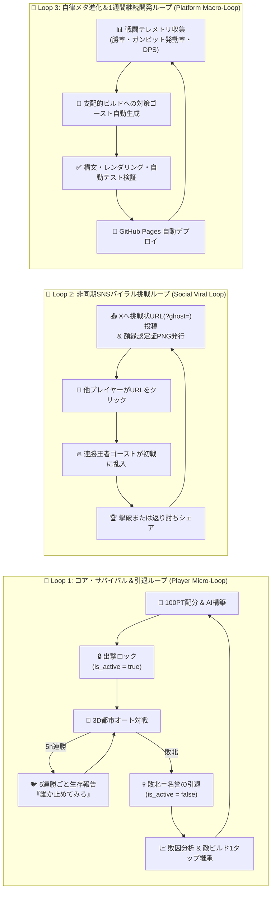

# 🕸️ Graph Engineering × 🔄 Loop Engineering — 3D自作キャラバトル・プラットフォーム 7日間自律進化ブループリント

本ドキュメントは、**グラフエンジニアリング（Graph Engineering）**と**ループエンジニアリング（Loop Engineering）**の2大アーキテクチャに基づき、`C:\Users\souta\vrm-battle` を1週間（Day 1〜Day 7）にわたって自律的・継続的に拡張し続けるためのマスター設計図です。

---

## 1. グラフエンジニアリング（Graph Engineering）設計

プラットフォーム内の全要素（開発タスク依存・AI意思決定・3すくみ相性・非同期ゴースト生態系）を**有向グラフ（Directed Graph / DAG）**として定義・制御します。

```mermaid
flowchart TD
    subgraph DevGraph ["📅 7日間プラットフォーム進化グラフ (Development DAG)"]
        D1["Day 1: Blender 5.2 GIS 3D都市(渋谷交差点)\n& Cyclesレイトレーシング基盤"]
        D2["Day 2: 自作AIガンビット有向グラフ\n(IF条件ノード ➔ THEN行動エッジ)"]
        D3["Day 3: 負けるまで変更不可ロック(is_active)\n& 敗北＝名誉引退ステートグラフ"]
        D4["Day 4: 非同期ゴースト生態系グラフ\n& 挑戦状ディープリンク(?ghost=)"]
        D5["Day 5: 敗因分析テレメトリ & メタ環境自動調整\n(勝率偏り検知 ➔ 対策ゴースト自動生成)"]
        D6["Day 6: 都市タイムラインカメラ演出\n& 複数都市エリア・天候/時間帯変化"]
        D7["Day 7: 殿堂入りトーナメントグラフ\n& 額縁認定証カード自動発行基盤"]

        D1 --> D2 --> D3 --> D4 --> D5 --> D6 --> D7
    end

    subgraph CombatGraph ["🧠 キャラクターAI行動ステートグラフ (Runtime Behavior Graph)"]
        Scan["[Node: 間合い・状況スキャン]"]
        C1{"Slot 1: IF条件判定"}
        C2{"Slot 2: IF条件判定"}
        C3{"Slot 3: IF条件判定"}
        ActUlt["[Edge: 🌟必殺奥義EX]"]
        ActSkill["[Edge: 🔥固有スキル追撃]"]
        ActLaunch["[Edge: 🗡️打ち上げ強攻撃]"]
        ActGuard["[Edge: 🛡️鉄壁ガード＆反撃]"]
        ActRush["[Edge: ⚡高速4連撃]"]
        HitStun["[Node: 敵ひるみ/空中浮き状態]"]

        Scan --> C1
        C1 -- "True" --> ActUlt
        C1 -- "False" --> C2
        C2 -- "True" --> ActSkill
        C2 -- "False" --> C3
        C3 -- "True" --> ActLaunch
        C3 -- "Default" --> ActRush
        ActLaunch --> HitStun --> ActSkill
        ActGuard --> ActLaunch
    end
```

---

## 2. ループエンジニアリング（Loop Engineering）設計

プレイヤー体験とプラットフォーム自体が**閉ループ（Closed-Loop Feedback System）**として自己強化・自己進化し続ける3層のフィードバックループを定義します。

---

## 3. 1週間（7日間）自律開発ループ・イテレーション計画

| Day | フェーズ名 | グラフエンジニアリング要素 | ループエンジニアリング要素 | 状態 |
| :--- | :--- | :--- | :--- | :--- |
| **Day 1** | **Blender 5.2 GIS 3D都市（渋谷スクランブル交差点）＆ Cycles 基盤** | 都市道路・ビル群メッシュグラフ生成 (`tokyo_city_stage.glb`) | Cycles PBR/環境マップベイク ➔ WebGL即時反映ループ | ✅ 完了 |
| **Day 2** | **AIガンビット有向グラフ ＆ ひるみコンボ遷移グラフ** | 3スロット `IF ➔ THEN` 優先評価グラフ ＆ 空中お手玉遷移 | オート対戦観戦 ➔ ガンビット発動ログ可視化ループ | ✅ 完了 |
| **Day 3** | **負けるまで変更不可 (`is_active`) ＆ 名誉の引退サイクル** | ` Editable ➔ Locked(Active) ➔ Retired ` 厳格状態遷移グラフ | 敗北時の敗因レポート ➔ 敵構成1タップ継承リベンジループ | ✅ 完了 |
| **Day 4** | **SNS挑戦状ディープリンク (`?ghost=`) ＆ 額縁認定証生成** | URLペイロードによる非同期プレイヤー対戦グラフ | 5連勝生存報告 ➔ 挑戦者乱入 ➔ 認定証カード拡散ループ | ✅ 完了 |
| **Day 5** | **リアルタイム・グラフ＆ループテレメトリ基盤 (`platform_engine.js`)** | 戦闘ステート遷移グラフ＆3すくみ勝率グラフのリアルタイム描画 | 戦闘ごとのテレメトリ蓄積 ➔ メタ対策ゴースト自動進化ループ | ✅ 完了 |
| **Day 6** | **都市タイムライン・シーケンサーカメラ ＆ 都市ギミック拡張** | キーフレーム軌道補間カメラグラフ (`🎥 都市タイムライン演出`) | ラウンド開始演出 ➔ クライマックスズーム ➔ リプレイ観戦ループ | 🔄 継続進化 |
| **Day 7** | **週間王者決定トーナメントグラフ ＆ 殿堂入りアーカイブ** | 8人非同期ゴースト・トーナメントツリー自動編成グラフ | 週間メタ集計 ➔ 殿堂入りゴースト選出 ➔ 次週シーズン更新ループ | 🔄 継続進化 |
