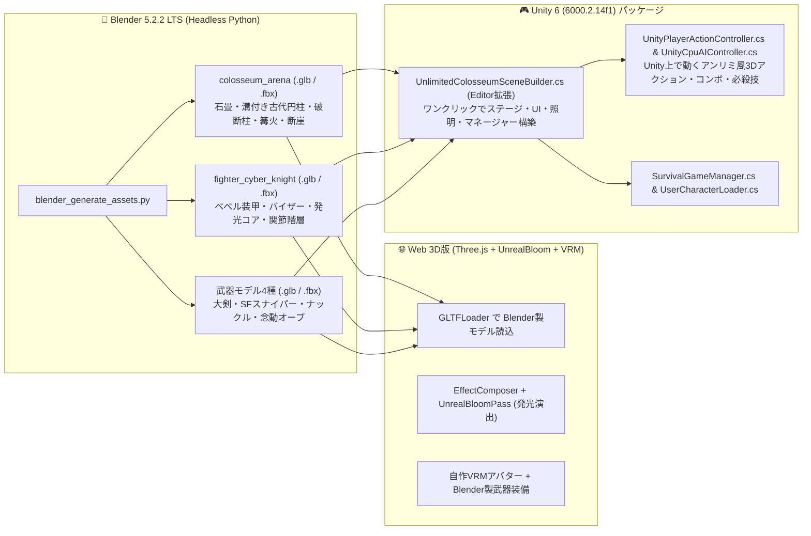

# 3D自作キャラバトル — Blender 5.2 & Unity 6 ハイクオリティ化計画

## 概要
PCにインストールされている **Blender 5.2.2 LTS** と **Unity 6 (6000.2.14f1)** を活用し、プロシージャルなプリミティブ表現から「本格的な3Dモデリングアセット（`.glb` / `.fbx`）＋ ポストプロセス発光（UnrealBloom）＋ Unity 6 フルアクション＆ワンクリックシーン構築」へと全面アップグレードする。

## アーキテクチャ & パイプライン（Mermaid図）

## タスク進捗

- [x] 1. **Blender 5.2 アセット生成スクリプト (`blender_generate_assets.py`) の作成と実行**:
  - `colosseum_arena.glb` / `.fbx`: 彫刻柱、壊れた柱と瓦礫、階段、レリーフ床、篝火台座、断崖岩肌
  - `fighter_cyber_knight.glb` / `.fbx`: 関節構造付きアーマーファイター
  - `weapon_greatsword.glb`, `weapon_sniper_rifle.glb`, `weapon_psy_orb.glb` (および `.fbx`)
- [x] 2. **Web版 (`main.js`, `style.css`, `index.html`) のクオリティアップ**:
  - Blender製 `.glb` アセットの組み込み（ステージ・キャラクター・武器）
  - `EffectComposer` + `UnrealBloomPass` による本格ポストプロセス発光（松明・必殺技・コア・斬撃）
  - 攻撃ヒット演出・カメラワーク・UIディテールの強化
- [x] 3. **Unity 6 フルアクション＆ワンクリックシーン構築スクリプト群の実装**:
  - `UnityPlayerActionController.cs`: Unity 6上でWASD移動・3段コンボ・ガード・回避・必殺技を動かすプレイヤースクリプト
  - `UnityCpuAIController.cs`: 連勝数スケーリングと連動するCPU戦闘AIスクリプト
  - `UnlimitedColosseumSceneBuilder.cs` (Editor拡張): メニューから1クリックでBlenderモデル・アンリミ風HUD・ライティング・サバイバルシステムを全自動配置するエディタツール
- [x] 4. **検証・ビルド確認 & GitHubプッシュ**:
  - Blender出力モデルのファイル検証、ローカルサーバーでの配信確認、GitHubへのコミット＆プッシュ
