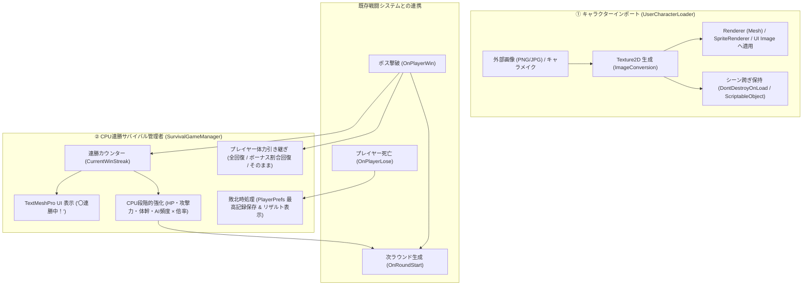

# 3D自作キャラバトル & Unity 6サバイバルシステム 開発計画

## 概要
1. Web版: Three.js & three-vrm によるアンリミ風3Dタイマンバトルゲーム（稼働中）
2. Unity 6版: 「ユーザー自作キャラのインポート ＆ CPU連勝サバイバルシステム」のC#スクリプト構築

## Unity 6 サバイバルシステム アーキテクチャ（Mermaid図）

## タスク進捗

### Web版 (完了)
- [x] 1. 古代遺跡コロシアム & 大海原ステージ
- [x] 2. プレイヤー操作 (コンボ, 必殺技, ガード, 回避, ロックオン)
- [x] 3. HP/SPゲージ & アンリミ風HUD
- [x] 4. CPU AI & 4スタイル
- [x] 5. VRMローカルD&D読み込み
- [x] 6. ローカルサーバー & GitHub Pages公開

### Unity 6 C#システム (完了)
- [x] 7. **`UserCharacterLoader.cs` の実装**:
  - 外部画像（PNG/JPG/バイト配列）の非同期ロード
  - URP (`_BaseMap`) & Built-in (`_MainTex`) 両対応のテクスチャ動的適用
  - 2Dスプライト・UI画像への適用
  - `DontDestroyOnLoad` によるシーン間データ永続化（名前、カラー、テクスチャ）
- [x] 8. **`SurvivalGameManager.cs` の実装**:
  - `CurrentWinStreak` カウント & TextMeshPro UI 更新
  - プレイヤー体力引き継ぎオプション（全回復 / 割合ボーナス回復 / そのまま）
  - CPUステータスの段階的強化倍率計算（最大HP、攻撃力、体幹ゲージ、AI行動インターバル）
  - ゲームオーバー時の `PlayerPrefs` ハイスコア保存 & リザルト表示
  - `OnPlayerWin()` / `OnPlayerLose()` イベントAPI
- [x] 9. **補助クラス・データモデル**:
  - `UserCharacterData.cs` (シリアライズ可能なキャラデータ)
  - `UserCharacterDataSO.cs` (ScriptableObjectラッパー)
  - `CpuBattleStats.cs` (CPUステータス定義)
  - `IBattleEntity.cs` (汎用ヘルス・ステータス連携インターフェース)
  - `SampleBattleEntity.cs` (即座に動作するサンプルコンポーネント)
- [x] 10. **GitHubへのコミット & プッシュ**:
  - Unityスクリプトをリポジトリへ反映、ドキュメント更新
