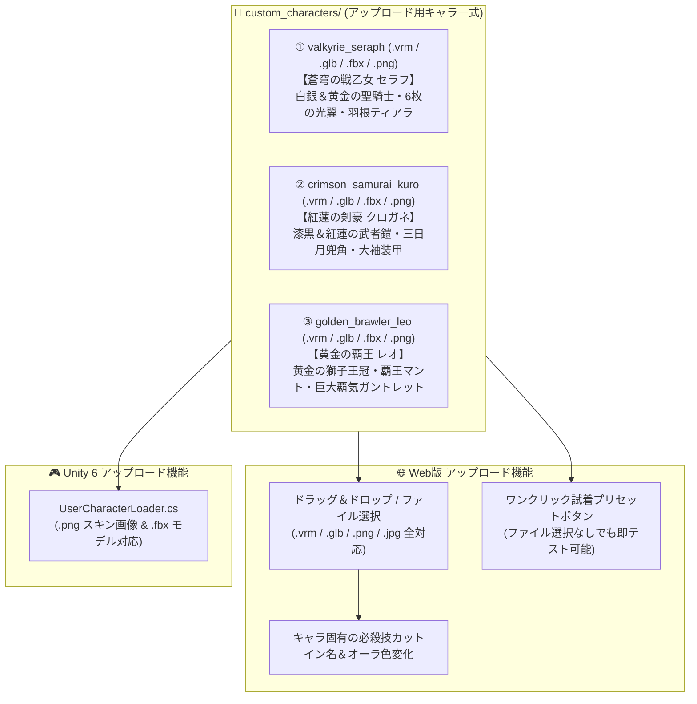

# 3D自作キャラバトル — アップロード用オリジナル自作キャラクター制作 & マルチフォーマット対応計画

## 概要
ユーザーが「自分のキャラとしてアップロード（ドラッグ＆ドロップ / ファイル選択）」してテスト・プレイできるよう、**Blender 5.2.2 LTS** でヒューマノイドボーン（Armature）と `VRMC_vrm` (VRM 1.0) メタデータを備えた **3体のオリジナル3Dキャラクター（`.vrm` / `.glb` / `.fbx` / `.png`）** を制作し、`custom_characters/` フォルダに出力する。

## 制作するアップロード用キャラクター3体（Mermaid図）

## タスク進捗

- [x] 1. **Blender 5.2 + VRM 1.0 ビルダースクリプト (`blender_generate_custom_chars.py`) の作成と実行**:
  - ヒューマノイド Armature（`hips`, `spine`, `chest`, `head`, `leftUpperArm`, `rightUpperArm`, `leftUpperLeg`, `rightUpperLeg` 等）の構築とウェイト付け
  - 3体（`valkyrie_seraph`, `crimson_samurai_kuro`, `golden_brawler_leo`）のモデリングと `.glb` / `.fbx` 出力
  - GLBバイナリへの `VRMC_vrm` (VRM 1.0) 拡張・メタデータ・ボーンマッピング注入による `.vrm` ファイル生成
  - Unity `UserCharacterLoader.cs` 用のカスタムキャラクターテクスチャ画像（`.png` 3種）の生成
- [x] 2. **Web版 (`main.js`, `index.html`, `style.css`) のアップロード機能拡張**:
  - `.vrm` に加え、`.glb` および `.png` / `.jpg`（テクスチャ動的貼り替え）のドラッグ＆ドロップ読み込みに対応
  - 読み込んだキャラクターに応じた固有必殺技カットイン名・斬撃カラーの自動反映
  - 画面下部のVRMドックに、`custom_characters/` 内の3体をすぐ試せるクイック召喚ボタンも併設
- [x] 3. **動作確認 & GitHubへのコミット・プッシュ**:
  - 生成された `.vrm` / `.glb` / `.fbx` / `.png` の検証、ローカルサーバー配信確認、GitHubプッシュ
