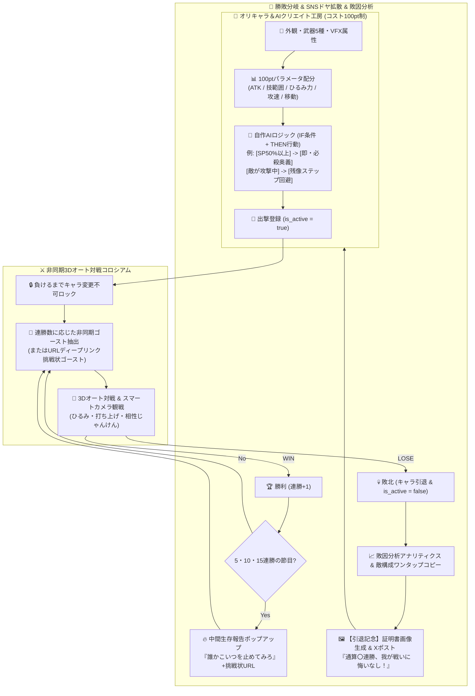

# 3D自作キャラバトル — 「完全オート(自作AIガンビット) × 非同期ゴースト対戦 × 負けるまで変更不可ロック × SNSドヤ証明＆敗因分析」実装計画

## 概要
ご提示いただいた企画仕様書に基づき、これまでの「アニメ調トゥーン3Dコロシアム＆ひるみコンボ＆100PT範囲内キャラメイク」をベースとして、以下のコア仕様を完全統合する。

1. **🤖 オート対戦（監督・観戦モード）＆ 自作AIロジック（IF条件＋THEN行動パーツ化）＆ シネマティックカメラ**:
   - プレイヤーが「クリエイター兼監督」として観戦できる **AUTOバトルモード（ON/OFF切替可）** と **UI非表示シネマティック観戦モード（配信映え用）** を搭載。
   - プログラム知識不要でキャラの頭脳を作れる **「IF（条件）＋ THEN（行動）」3スロットのAIガンビット設定** を工房に追加。
2. **🔒 「一度出撃したら負けるまで変更不可 (`is_active = true`)」＆「敗北＝引退（ゼロから作り直し）」**:
   - キャラクターを出撃登録（`is_active = true`）した瞬間から、**負けるまでクリエイト工房での変更・修正を完全遮断（グレーアウト＆ロック）**。
   - 敗北した瞬間に `is_active = false` となり、そのキャラは **「【引退】」** として殿堂入り・消滅し、新しいキャラをゼロから作り直せる（または自分を倒した敵の構成をワンタップコピーしてリベンジできる）サイクルを実装。
3. **👻 非同期ゴースト対戦（連勝数マッチングフィルター）＆ 挑戦状ディープリンク (`?ghost=...`)**:
   - 現在の連勝数に応じて、サーバー/ローカルプール内の「他プレイヤーの自作キャラ防衛ゴースト（1〜3連勝帯、5〜8連勝帯、10連勝以上の怪物ゴースト）」を自動マッチング。
   - **挑戦状ディープリンク機能**: SNSシェア時のURLに自分のキャラデータ（見た目・100PT配分・AI・連勝数）を埋め込み、リンクを踏んだ人が**その連勝中の王者ゴーストに一発で挑戦できる**仕組みを実装。
4. **🏆 インセンティブ不要の「SNSドヤ機能」最大化 ＆ 敗因分析（アナリティクス）**:
   - **① 中間報告（生存報告）ポップアップ**: 5連勝・10連勝・15連勝…の節目に「現在〇連勝中！戦績をSNSに轟かせますか？」を表示し、「誰かこいつを止めてみろ」＋挑戦状URLをワンタップ投稿。
   - **② 敗北時の「【引退記念】ポスト」**: 「【引退】〇〇（キャラ名）、強敵〇〇の前に散る。通算〇〇連勝。我が戦いに悔いなし！」をワンタップ投稿。
   - **③ ワンタップ「証明書」額縁画像生成 (Canvas)**: キャラ肖像・3Dスペック・撃破数・連勝数をデザイン額縁付きPNG画像として自動生成＆保存可能。
   - **④ 敗因分析（アナリティクス）＆ 構成コピー**: リザルト画面で「与ダメージ」「被ダメージ」「ひるみ奪取数」「生存時間」「敗因アドバイス」をグラフ可視化し、勝った相手の構成をワンタップでコピーして次のキャラ作成へ活かせるUXを実装。

## システムアーキテクチャ（Mermaid図）

## タスク進捗

- [x] 1. **Blender 5.2 Cycles レイトレーシング高精細アセット生成 (`blender_cycles_render.py` ➔ `assets/renders/*.png`)**:
  - `cycles_arena_ground.png` (レイトレーシング石畳＆発光ルーン刻印コロシアム床)
  - `cycles_sky_env.png` (360°パノラマ空・大海原・太陽光反射環境マップ)
  - `cycles_hero_portrait.png` / `cycles_oni_portrait.png` / `cycles_battle_showcase.png` (Cycles 3点スタジオ照明ポートレート＆バトルショーケース)
- [x] 2. **UI拡張 (`index.html`, `style.css`)**:
  - 観戦用コントロールバー（`🤖 AUTO対戦: ON/OFF`、`🎬 観戦カメラ(UI非表示)`、`🐦 生存報告`）
  - クリエイト工房への **「🧠 自作AIロジック（IF条件＋THEN行動）3スロット設定」**＆ **「⚔️ 相性タイプ（スピード型 / 一撃必殺型 / 鉄壁カウンター型）」** 追加
  - **5・10・15連勝時の「🔥 中間生存報告ポップアップ」**
  - **敗北時の「【引退記念】ドラマリザルト ＆ 📊 敗因分析アナリティクス ＆ 🖼️ 証明書画像生成 ＆ 📋 敵構成ワンタップコピー」モーダル**
- [x] 3. **Cycles PBR/Toon + UnrealBloomPass・非同期ゴースト対戦・自作AIガンビット・負けるまで変更不可ロック・挑戦状URL・証明書Canvas生成の実装 (`main.js`)**
- [x] 4. **Unity 6 スクリプトの同期更新 (`SurvivalGameManager.cs`)**
- [x] 5. **動作確認 ＆ GitHubへのプッシュ**

---

## フェーズ6：動画（`youtu.be/uk404c43pRY`「[Blender] 街をひと手間でそれっぽく作る」）準拠 — 「Blender 5.2 3D都市（東京・渋谷スクランブル交差点＆高層ビル群）バトルフィールド」構築

- [ ] 1. **Blender 5.2 + Cycles による実在都市風3Dビル群モデル（`.glb`）＆ スクランブル交差点アスファルトテクスチャ生成 (`blender_city_generator.py`)**:
  - GIS都市区画データ風に道路網とビル群フットプリントを立体押し出し（Extrude）し、窓ガラス発光・屋上設備・ネオン看板・街路樹・信号機を備えた3D都市モデル `assets/models/tokyo_city_stage.glb` をBlender 5.2で生成
  - Blender 5.2 `CYCLES` レイトレーシングで「渋谷スクランブル交差点アスファルト＆白線横断歩道・マンホール・濡れ路面反射テクスチャ (`assets/renders/cycles_city_ground.png`)」「都市夜景＆夕景360°パノラマ環境マップ (`assets/renders/cycles_city_sky.png`)」「都市バトル背景 (`assets/renders/cycles_city_showcase.png`)」をレンダリング
- [ ] 2. **Three.js フィールドを「東京・渋谷スクランブル交差点＆高層ビル街 (`createTokyoCityMetropolis`)」へ全面刷新 (`main.js`)**:
  - `assets/models/tokyo_city_stage.glb` と `cycles_city_ground.png` / `cycles_city_sky.png` を統合し、ガードレール・街灯・信号機・ネオンビル・屋上航空障害灯・街路樹・濡れた路面のスペキュラ反射を備えたリアルな日本の大都会バトルフィールドを構築
- [ ] 3. **都市タイムライン・カメラワーク演出 ＆ GitHub Pages 反映**

