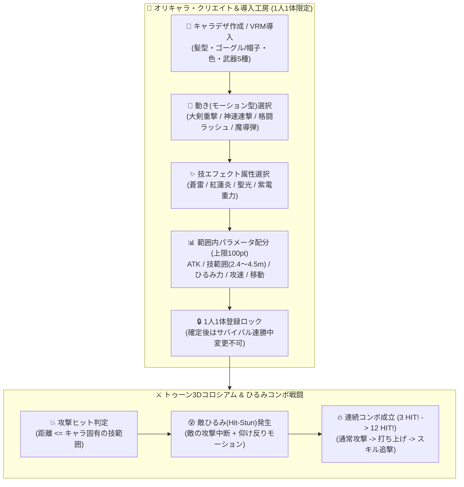

# 3D自作キャラバトル — アニメ調トゥーンコロシアム ＆ オリキャラ・クリエイト工房（1人1体限定・ひるみ連撃・パラメータ配分）実装計画

## 概要
ユーザー提示の完成イメージ画像（青髪ゴーグル大剣主人公 vs 赤鬼ハンマーボス、女剣士・魔法使い・格闘家など多彩なオリキャラ、斜め平行四辺形ゲージHUD、左下ATTACK/右下SKILLの4ボタンパッド、青空と海と大樹の遺跡コロシアム）を完全再現し、以下の要素を統合実装する。

1. **アニメ調トゥーン（セルシェーディング＋黒輪郭線）ビジュアル ＆ 昼の絶景コロシアム**:
   - 全キャラクター・ボスに**アニメ調トゥーンシェーディング（階調陰影）＋黒アウトライン（Inverted Hull輪郭線）**を適用。
   - **昼の青空・大海原・巨大樹・古代石柱・木の柵と光の境界線・砂煙が舞う土の闘技場**を構築。
   - CPUボスも「赤鬼オーガ（巨大ハンマー）」「棘ベヒーモス」「古代ゴーレム」「重装パラディン」「リザードマン」の5種がラウンドごとに登場。
2. **「攻撃が当たったらひるむ（Hit-Stun）」＆「本格コンボチェイン（打ち上げ・叩きつけ・12 HIT!）」**:
   - 攻撃ヒット時に敵がのけぞり行動が中断される**「ひるみ（Hit-Stun）時間」**と**「体幹（Poise）ブレイク」**を実装。
   - 通常連撃（最大5段〜）➔ 打ち上げ（Launch）➔ スキル追撃（Skill）➔ 必殺技（EX Special）まで途切れず繋がる本格コンボシステム。
3. **ユーザー側「オリキャラ・クリエイト＆導入工房」（1人1体限定ロック）**:
   - **① キャラデザ（外観・髪型・装備・武器・カラー・VRM/画像導入）**:
     - ゴーグル蒼剣士 / ポニーテール女剣士 / 星詠み魔導士 / サイバー格闘家 / 外部VRM・PNG導入
     - 武器5種（ルーン大剣・片手剣＆盾・魔導杖・覇王ナックル・紅蓮太刀）＋髪色・服色・オーラ色カスタマイズ
   - **② 動き（モーション型）の選択**:
     - 重撃大剣型 / 神速居合い型 / 疾風アッパー格闘型 / 遠距離魔導シューター型
   - **③ 技エフェクト（VFX属性）の選択**:
     - 蒼雷プラズマ / 紅蓮フレイム / 聖光アストラル / 紫電グラビティ
   - **④ 各種パラメータの「決められた範囲＆総コスト（100pt）内」での作り込み**:
     - **攻撃力 (ATK)**: `0.85x 〜 1.40x`
     - **技範囲・リーチ (RANGE)**: `2.4m 〜 4.5m`（斬撃・衝撃波のサイズも連動拡大）
     - **ひるませ力 (STUN)**: `0.80x 〜 1.50x`（敵の仰け反り時間・コンボの繋がりやすさに直結）
     - **攻撃速度 (ATK SPD)**: `0.85x 〜 1.35x`
     - **移動速度 (SPD)**: `5.2 〜 8.0`

## システムアーキテクチャ（Mermaid図）

## タスク進捗

- [x] 1. **UI刷新 (`index.html`, `style.css`)**:
  - 画像通りの斜め平行四辺形ゲージHUD（左上PLAYER(自作)顔アイコン＋HP/SPテンション、中央99ラウンド、右上CPU顔アイコン＋HP）
  - 左下「ATTACK」4ボタンパッド（通常・連撃・打ち上げ・ガード）＆右下「SKILL」4ボタンパッド（スキル1・必殺技・ステップ・ジャンプ）
  - **「🎨 オリキャラ・クリエイト工房（1人1体限定）」モーダルUI**（キャラデザ・動き・エフェクト・範囲内パラメータ配分スライダー）
- [x] 2. **アニメ調トゥーン3D描画 ＆ 細密キャラデザ・ボス5種・ひるみコンボエンジン (`main.js`)**:
  - 昼の青空と海、大樹、石柱、柵のある遺跡コロシアム
  - トゥーンシェーディング＋黒輪郭線付きのプレイヤー（蒼髪ゴーグル大剣士など）＆5大ボス（赤鬼ハンマー、棘ベヒーモス、ゴーレム、重装騎士、リザードマン）
  - 攻撃ヒット時の「ひるみ（Hit-Stun）」「打ち上げ（Air Juggle）」「連続コンボチェイン」
- [x] 3. **Unity 6 スクリプトの同期アップデート (`UserCharacterLoader.cs`, `UnityPlayerActionController.cs`)**
- [x] 4. **動作確認 ＆ GitHubへのプッシュ**
