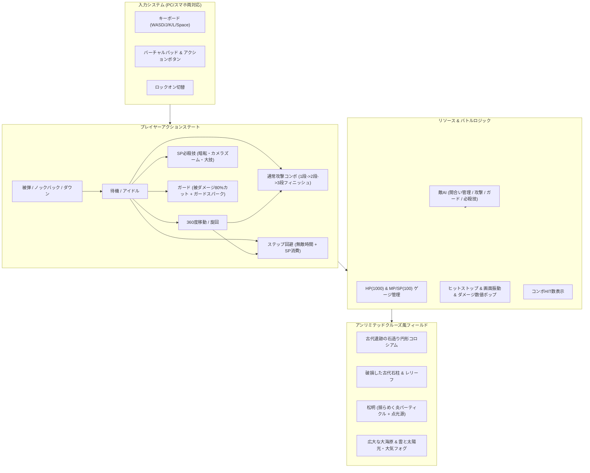

# 3D自作キャラバトル（アンリミテッドクルーズ風タイマンバトル仕様）開発計画

## 概要
Wii「ワンピース アンリミテッドクルーズ」のタイマンバトル（VS/サバイバルモード）のゲーム性とフィールド環境を完全オマージュ。自作VRMアバターを使って、古代遺跡の断崖闘技場を舞台に、HP/MP(SP)リソース、リアルタイムコンボ攻撃、必殺技カットイン、ガード、回避、ロックオンを駆使した本格3Dアクションバトルを実現する。

## 状態遷移・システムアーキテクチャ（Mermaid図）

## タスク進捗

- [x] 1. **アンリミ風フィールドの構築**:
  - 古代遺跡の石畳アリーナ、壊れた石柱群、揺らめくトーチの炎（パーティクル＋ライト）、大海原と空・大気フォグ
- [x] 2. **リアルタイムプレイヤーアクション & コントローラ実装**:
  - 移動（WASD & バーチャルスティック）、ロックオンTPSカメラ、旋回
  - 3段通常攻撃コンボ、ヒット判定、攻撃エフェクト
  - ガード（Space）、ステップ回避（L）、SP必殺技（K: 暗転＆技名カットイン＆大爆発）
- [x] 3. **HP/MP(SP)リソース & アンリミ風HUD**:
  - HPバー（ダメージ蓄積追随バー付き）、SP/MPバー（攻撃ヒット・時間でチャージ）
  - コンボHIT数＆合計ダメージ表示、ダメージポップアップ
  - スマホ用オンスクリーンコントローラー（移動パッド、攻撃/必殺/ガード/回避ボタン）
- [x] 4. **敵CPUの本格アクションAI**:
  - プレイヤーとの距離・間合いに応じた接近・後退・通常攻撃・ガード・必殺技
  - 4スタイル（拳法家・重戦士・サイキッカー・スナイパー）の戦闘行動差別化
- [x] 5. **VRMアバターとの完全統合**:
  - ドロップされた自作VRMアバターのボーン制御（移動・攻撃モーション・ダウン・勝利ポーズ）
- [x] 6. **テスト・動作検証・GitHubへのプッシュ**:
  - ローカルサーバーでの動作確認、GitHubコミット＆プッシュ
