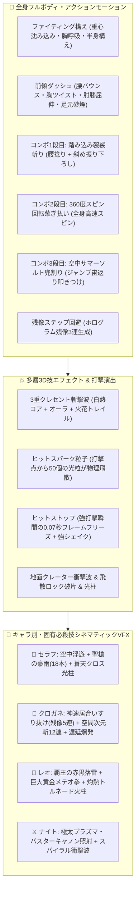

# 3D自作キャラバトル — 本格フルボディモーション ＆ 超ド派手VFXエフェクト大改修計画

## 概要
「キャラクターの動き」と「技のエフェクト」を劇的に進化させるため、単調な回転や単純なリング表示を刷新し、**全身多関節キーフレーム補間モーション（踏み込み・回転斬り・ジャンプ兜割り・残像ステップ）**と、**キャラクター固有の超ド派手3D必殺技エフェクト＆ヒットストップ＆火花バーストシステム**を実装する。

## モーション ＆ VFX 強化アーキテクチャ（Mermaid図）

## タスク進捗

- [x] 1. **全身アクションモーションエンジンの実装 (`main.js` & `UnityPlayerActionController.cs`)**:
  - 格闘構えアイドル、前傾ダッシュ＆砂煙パーティクル
  - コンボ1段目（袈裟斬り）、2段目（360度スピン薙ぎ払い）、3段目（ジャンプ宙返り叩きつけスラム）
  - ステップ回避時のホログラム残像（Afterimage Ghosts）生成
- [x] 2. **多層3Dエフェクト（VFX）＆ヒットストップの実装**:
  - 多層クレセント斬撃メッシュ、50個の物理飛散ヒットスパーク、岩石破片（Debris）、光の柱（Light Pillar）、赤黒サンダーボルト
  - 打撃瞬間のヒットストップ（0.07秒フリーズ）＆ダイナミックカメラワーク
- [x] 3. **キャラクター別・固有必殺技3D演出の実装**:
  - セラフ（聖槍の豪雨＆聖光柱）、クロガネ（居合い瞬間移動＆空間次元斬14連）、レオ（覇王雷撃＆巨大黄金拳メテオ）、サイバーナイト（極太プラズマレーザー）
- [x] 4. **動作確認 & GitHubへのプッシュ**
