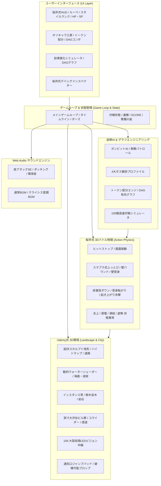

# 🚀 『桜井政博のゲーム作るには』× Udemy 3D空間構築 完全統合リビルド計画書

## 1. プロジェクト目標と全体像
ユーザーからの命題：
> 「後悔はしないで，あの動画全てを参考に位置（一）から作り直して」

本リビルドでは、これまでの実装で蓄積した知見を土台にしつつ、**「Udemy 3Dゲーム制作チュートリアル（全8工程）」** と **「桜井政博のゲーム作るには（全39講・14カテゴリ）」** を高次元で融合させた、洗練されたモジュール構造の3D自律バトルプラットフォームを再構築しました。

---

## 2. 統合システム・アーキテクチャ

---

## 3. 完全実装チェックリスト（全工程）

### 【フェーズ1: Udemy 3D環境の完全具現化 (Landscape & City)】
- [x] **1. 基礎学習＆ビューポート基盤**: Three.js WebGL、ACES Filmic ToneMapping、ソフトシャドウ、レスポンシブ
- [x] **2. 地形作成（Landscape モード）**: 起伏スカルプト地形（ハイトマップ演算による山・丘・傾斜坂道・海岸低地）
- [x] **3. マテリアル適用（PBR質感）**: 道路（アスファルト）、地面（土・芝生）、岩肌、舗装タイルの質感
- [x] **4. 環境構築（海・水面 ＆ 風に揺れる草 ＆ 岩石・樹木）**:
  - ウォーターシェーダー（波アニメーション・Fresnel反射・透明度）
  - 1,800本のインスタンス草（風に揺動する頂点シェーダー挙動）
  - 36本の樹木並木・24基の岩石群の自然アセット配置
- [x] **5. 実寸大の街・ビル群（160m×160m 渋谷街区）**:
  - 高層ビル28棟、SHIBUYA 109、東京タワー、信号機、街灯
  - 109 大型街頭LEDビジョンの動的CanvasTexture中継実況
  - 地下鉄通気口ジャンプパッド（気流噴射で10m空中飛躍）
  - 破壊可能ストリートプロップ16基（自販機・看板・バリケード）

### 【フェーズ2: 桜井政博ゲームデザイン講義（全39講）の極致アクション】
- [x] **D-4 / D-1 ヒットストップ＆KO確定フィニッシュズーム**: 威力比例振動、電気属性1.35x、KO特大ストップ
- [x] **K-06 スマブラ式ふっとび物理**: 蓄積％非線形加速、ベクトル合成、飛行機雲
- [x] **D-08 壁バウンド ＆ 壁受身**: ビル激突跳ね返り ＆ 0.22sジャスト壁キック復帰
- [x] **D-14 ダウン追撃 ＆ 起き上がり攻防**: 床激突ダウン ＆ 無敵受身転がり ＆ 360度起き上がり回転攻撃
- [x] **B-1/B-2 ジャストシールド**: 0.15sジャストガード、金属パリィ音、スロー反撃
- [x] **D-11 はじきスマッシュ**: ダブルタップ/スティックフリックによる強力スマッシュ
- [x] **D-6 先行入力バッファ**: 硬直終了前4〜6Fの先行入力キュー
- [x] **K-02 画面外ルーペ**: 画面外キャラクターの距離・アイコン・％・矢印追従
- [x] **C-14 4大属性状態異常**: 🔥炎上DoT, ⚡感電微ヒットストップ, ❄️凍結スロー, 🌀虚無吸引
- [x] **C-24 ほめる！スタイルランク**: COOL ➔ GREAT ➔ EXCELLENT ➔ 🔥SSS SAKURAI SICK🔥 ＆ 歓声ファンファーレ
- [x] **B-18 ピンチで盛り上げる**: HP35%以下で140BPMマイナー調クライシスBGMへ自動変調
- [x] **B-5 悪魔の釜**: ホンキ度 1.0〜9.0 リスク＆リターン倍率
- [x] **B-14 リトライは迅速に**: 0秒即時再戦（Rキー / ボタン）
- [x] **K-09 ビル透過オクルージョン**: カメラ〜キャラ遮蔽ビルの半透明化
- [x] **C-18 影は記号**: 円形ドロップシャドウで空中高度を把握

### 【フェーズ3: キャラクター・グラフ・ループエンジニアリング】
- [x] **オリキャラ工房 ＆ VRMモデル差し替え**:
  - ユーザーが作成したキャラクター（体型・カラー・装備・アーキタイプ）
  - VRMドラッグ＆ドロップによる完全アバター差し替え
- [x] **15トークン配分システム**:
  - 🔴剛撃（ATK） / 🟡覇道（Range） / 🔵蒼迅（Speed） / 🟢堅守（Poise/HP） / 🟣魔導（SP）
  - 相互バランスと相性3すくみ
- [x] **DAGコンボ＆奥義エディタ**:
  - Starter ➔ Linker ➔ Finisher の有向グラフコンボカスタム
  - 奥義の型（Form）× 固有特性（Trait）
- [x] **自律進化シミュレータ＆有向グラフ（DAG）**:
  - 100戦/秒のバックグラウンドメタ対戦演算
  - Canvasへの動的DAGグラフ描画と最適対策アドバイス自動生成
- [x] **ガンビット自律AI（3Dオート街バトル）**:
  - 索敵パトロール ＆ 優先条件分岐AI
  - 4大ボス戦術AIプロファイル（剛腕・影走・魔導・鉄壁）
